# 🎓 ScholarConnect – PG Scholarship Management Portal

A modern full-stack PG Scholarship Management Portal that helps students discover postgraduate scholarship opportunities, check eligibility, submit applications, upload required documents, and track application status through a centralized web application.

The system provides separate portals for Admin and Student users with secure JWT-based authentication and role-based access control.

---

## 🚀 Project Overview

ScholarConnect is designed to simplify the postgraduate scholarship application and management process.

Students can register, log in, explore available scholarships, check eligibility, complete their application forms, upload supporting documents, save drafts, submit applications, download application PDFs, and receive notifications.

Administrators can manage scholarship schemes, review applications, verify documents, request corrections, approve or reject applications, manage student information, and generate scholarship reports.

The application follows a role-based architecture with separate Admin and Student portals.

---

## ✨ Features

### 🔐 Authentication

- Student Registration
- Student Login
- Admin Login
- JWT Authentication
- Role-Based Authorization
- Secure API Access
- Token-Based Authorization
- Protected Routes
- Logout
- Email-Based User Identification

---

### 👨‍💼 Admin Module

The Admin module provides centralized control over scholarship operations.

#### 📊 Admin Dashboard

Admin can view:

- Total Students
- Total Scholarships
- Total Applications
- Pending Applications
- Approved Applications
- Rejected Applications
- Application Statistics
- Scholarship Overview

---

#### 📄 Application Management

Admin can:

- View All Scholarship Applications
- Search Applications
- Filter Applications
- View Application Details
- View Student Information
- View Scholarship Information
- Review Submitted Applications
- Track Application Status
- Request Application Corrections
- Approve Applications
- Reject Applications
- View Application Review Information

##### Application Status

```text
DRAFT
SUBMITTED
UNDER_REVIEW
CORRECTION_REQUESTED
APPROVED
REJECTED
```

---

#### 👥 Student Management

Admin can:

- View Registered Students
- Search Students
- View Student Details
- View Student Contact Information
- View Student Application Information
- Monitor Student Application Status

---

#### 🎓 Scholarship Management

Admin can:

- Add Scholarships
- View Scholarships
- Edit Scholarship Details
- Search Scholarships
- Activate Scholarships
- Deactivate Scholarships
- Manage Scholarship Information
- Configure Scholarship Eligibility
- Manage Scholarship Application Periods

##### Scholarship Information

- Scholarship Name
- Scholarship Description
- Education Level
- Eligible Category
- Eligible Course
- Maximum Family Income
- Award Amount
- Application Start Date
- Application End Date
- Scholarship Status

The portal supports postgraduate scholarship management and configurable eligibility information.

---

#### 📊 Scholarship Reports

Admin can:

- Select a Scholarship
- Select Report Start Date
- Select Report End Date
- View Scholarship Reports
- View Application Statistics
- View Pending Applications
- View Approved Applications
- View Rejected Applications
- View Application Details
- Download Scholarship Report PDFs

##### Report Information

- Total Applications
- Submitted Applications
- Under Review Applications
- Correction Requested Applications
- Pending Applications
- Approved Applications
- Rejected Applications

The selected report period is validated against the scholarship application period.

---

#### 📁 Document Verification

Admin can:

- View Uploaded Student Documents
- View Document Details
- Verify Documents
- Reject Documents
- Add Verification Remarks
- Track Document Verification Status
- Review Student Supporting Documents

##### Document Types

- Photograph
- Signature
- Aadhaar Card
- PAN Card
- Ration Card
- Bank Passbook
- 10th Marksheet
- 12th Marksheet
- Graduation Marksheet
- Previous Year Marksheet
- Income Certificate
- Domicile Certificate
- Non-Creamy Layer Certificate
- Caste Certificate
- Caste Validity Certificate
- Bonafide Certificate
- Other Supporting Documents

Document requirements depend on the scholarship scheme and application configuration.

---

### 👨‍🎓 Student Module

Students have a separate portal for managing their scholarship applications.

#### 📊 Student Dashboard

Students can view:

- Available Scholarships
- My Applications
- Draft Applications
- Submitted Applications
- Application Status
- Notifications
- Scholarship Information

---

#### 🎓 Scholarship Opportunities

Students can:

- View Available Scholarships
- Search Scholarships
- View Scholarship Details
- Check Eligible Education Level
- Check Eligible Categories
- Check Eligible Courses
- View Maximum Family Income Criteria
- View Award Amount
- Check Application Start Date
- Check Application End Date
- Explore Scholarship Opportunities

---

#### 📝 Scholarship Application

Students can:

- Start a New Application
- Select an Available Scholarship
- Complete Personal Information
- Enter Family Information
- Enter Bank Information
- Enter Current Education Details
- Add Previous Education Details
- Enter Scholarship Application Reason
- Save Application as Draft
- Edit Draft Applications
- Upload Required Documents
- Review Application Details
- Submit Scholarship Applications

---

#### 📁 Document Upload

Students can upload the documents required for their selected scholarship.

##### Document Features

- Upload Photograph
- Upload Signature
- Upload Supporting Documents
- View Uploaded Documents
- Track Document Verification Status
- View Verification Remarks
- Replace Rejected Documents where applicable

The backend validates uploaded document types and file content.

---

#### 📋 My Applications

Students can:

- View All Applications
- View Draft Applications
- View Submitted Applications
- View Application Details
- Track Application Status
- View Admin Remarks
- Edit Applications when corrections are requested
- Submit Applications
- Download Application PDFs

---

#### 📄 Application PDF

Students can download their scholarship application as a PDF.

The application PDF includes relevant information such as:

- Student Details
- Family Information
- Bank Information
- Current Education Details
- Previous Education Details
- Scholarship Information
- Supporting Document Information
- Application Status

---

#### 🔔 Notifications

Students can:

- View Notifications
- Receive Application Updates
- View Correction Requests
- View Approval Updates
- View Rejection Updates
- Track Important Application Information

---

#### 👤 Student Profile

Students can:

- View Profile
- View Personal Information
- View Contact Information
- View Account Information
- View Education Information
- Manage Profile Information

---

## 🔄 Application Workflow

The complete scholarship application workflow is:

```text
Student Registration
        ↓
Student Login
        ↓
Student Dashboard
        ↓
Explore Scholarships
        ↓
Check Eligibility
        ↓
Select Scholarship
        ↓
Complete Application Form
        ↓
Upload Required Documents
        ↓
Save Draft / Submit Application
        ↓
Admin Reviews Application
        ↓
Document Verification
        ↓
Application Decision
        ↓
Approved / Rejected / Correction Requested
        ↓
Student Receives Notification
        ↓
Track Application Status
        ↓
Download Application PDF
```

---

## 🏗️ Project Architecture

ScholarConnect follows a full-stack architecture.

```text
ScholarConnect
│
├── Frontend
│   └── React.js
│
├── Backend
│   └── Spring Boot
│
└── Database
    └── MySQL
```

The React frontend communicates with the Spring Boot backend through REST APIs.

The backend handles authentication, business logic, scholarship management, application processing, document management, and report generation.

MySQL stores student, scholarship, application, document, and review information.

---

## 🛠️ Technology Stack

### Frontend

- React.js
- JavaScript
- HTML5
- CSS3
- React Router
- Axios
- Lucide React

### Backend

- Java 21
- Spring Boot 3.5.7
- Spring Web
- Spring Data JPA
- Spring Security
- Spring Boot Validation
- JWT Authentication
- Hibernate ORM
- Maven
- REST APIs
- OpenPDF

### Database

- MySQL 8
- MySQL Connector/J

### Development Tools

- Visual Studio Code
- Eclipse
- Postman
- MySQL Workbench
- Git
- GitHub

---

## 📂 Project Structure

```text
ScholarConnect/
│
├── backend/
│   ├── pom.xml
│   └── src/
│       └── main/
│           ├── java/
│           │   └── com/scholarship/portal/
│           │       ├── config/
│           │       ├── controller/
│           │       ├── dto/
│           │       ├── entity/
│           │       ├── enums/
│           │       ├── exception/
│           │       ├── repository/
│           │       ├── security/
│           │       └── service/
│           │
│           └── resources/
│               └── application.properties
│
├── frontend/
│   ├── public/
│   ├── src/
│   │   ├── components/
│   │   ├── context/
│   │   ├── pages/
│   │   │   ├── admin/
│   │   │   └── student/
│   │   ├── services/
│   │   └── styles/
│   ├── package.json
│   └── package-lock.json
│
├── screenshots/
│   ├── 01.Guest_Page.jpeg
│   ├── 02.Login_Page.jpeg
│   ├── 03.Registration_Page.jpeg
│   ├── 04.Admin_Dashboard.jpeg
│   ├── 05.Admin_Applications.jpeg
│   ├── 06.Admin_Students.jpeg
│   ├── 07.Admin_Scholarships.jpeg
│   ├── 08.Admin_Reports.jpeg
│   ├── 09.Student_Dashboard.jpeg
│   ├── 10.Student_Scholarship.jpeg
│   ├── 11.Apply_Scholarship.jpeg
│   ├── 12.Student_Application.jpeg
│   ├── 13.Application_Pdf.jpeg
│   ├── 14.Student_Notifications.jpeg
│   └── 15.Student_Profile.jpeg
│
├── .gitignore
└── README.md
```

---

## 🗄️ Database

The application uses MySQL to store scholarship portal information.

### Main Database Entities

```text
users
scholarships
scholarship_applications
education_details
uploaded_documents
application_reviews
notifications
```

These are the main entities used by the application. Additional tables may be created by the JPA entity relationships and configuration.

### Database Responsibilities

- User Account Management
- Student Information
- Scholarship Information
- Scholarship Applications
- Education Details
- Document Upload Information
- Document Verification
- Application Reviews
- Student Notifications

---

## 🔌 Backend API

### Base URL

```text
http://localhost:8080/api
```

The backend provides REST APIs for authentication, scholarship management, student applications, document management, admin operations, and reports.

### 🔐 Authentication

```text
/api/auth/**
```

Provides authentication and user account operations.

### 🎓 Scholarships

```text
/api/scholarships/**
```

Provides scholarship information and available scholarship operations.

### 📝 Applications

```text
/api/applications/**
```

Provides application creation, editing, submission, listing, and application details.

### 👤 Student

```text
/api/student/**
```

Provides student-related operations.

### 👨‍💼 Admin

```text
/api/admin/**
```

Provides administration and scholarship management operations.

### 📁 Documents

```text
/api/documents/**
```

Provides document upload and document management operations.

### 🔔 Notifications

```text
/api/notifications/**
```

Provides student notification operations.

### 📊 Reports

```text
/api/admin/reports/**
```

Provides scholarship reporting and PDF generation.

> Refer to the backend controllers for the exact HTTP methods, request parameters, and API endpoints.

---

## 🔐 JWT Authentication Flow

ScholarConnect uses JWT-based authentication to protect its APIs.

```text
User Login
    ↓
Frontend Sends Email + Password
    ↓
Backend Validates Credentials
    ↓
Spring Security Authentication
    ↓
JWT Token Generated
    ↓
Frontend Receives Token
    ↓
Token Included in API Requests
    ↓
JWT Authentication Filter
    ↓
Token Validation
    ↓
User Role Identified
    ↓
Protected API Access
```

---

## 👥 Role-Based Access Control

The system provides separate access levels for Admin and Student users.

### ADMIN

- Dashboard
- Applications
- Students
- Scholarships
- Reports
- Document Verification

### STUDENT

- Dashboard
- Scholarships
- Apply Scholarship
- My Applications
- Notifications
- Profile

Protected backend endpoints use Spring Security role-based authorization.

---

## 📄 PDF Generation

ScholarConnect supports PDF generation for scholarship application and administrative reporting.

### Student Application PDF

- Student Application Details
- Scholarship Details
- Family Information
- Bank Information
- Education Information
- Supporting Document Information

### Admin Scholarship Report PDF

- Scholarship Information
- Selected Report Period
- Application Statistics
- Pending Applications
- Approved Applications
- Rejected Applications
- Application Details

---

## ▶️ How to Run the Project

### 1. Clone the Repository

```bash
git clone https://github.com/maneshvedpathak307-sys/ScholarConnect.git
cd ScholarConnect
```

### 2. Configure MySQL

Create the database:

```sql
CREATE DATABASE scholarship_portal;
```

Configure your database connection in:

```text
backend/src/main/resources/application.properties
```

##### Example

```properties
spring.datasource.url=jdbc:mysql://localhost:3307/scholarship_portal?createDatabaseIfNotExist=true&useSSL=false&allowPublicKeyRetrieval=true&serverTimezone=UTC

spring.datasource.username=root

spring.datasource.password=your_password
```

Update the port, username, and password according to your local MySQL configuration.

**Important:** Do not upload your real database password, JWT secret, email credentials, or other private configuration values to GitHub. Use environment variables for secrets.

### 3. Run Backend

Open a terminal in the project directory:

```bash
cd backend
```

Make sure Java 21 and Maven are installed.

##### Check Java

```bash
java -version
```

##### Check Maven

```bash
mvn --version
```

Run the Spring Boot application:

```bash
mvn spring-boot:run
```

**Backend URL:**

```text
http://localhost:8080
```

### 4. Run Frontend

Open another terminal:

```bash
cd frontend
```

Install dependencies:

```bash
npm install
```

Start the React application:

```bash
npm start
```

**Frontend URL:**

```text
http://localhost:3000
```

---

## 📸 Project Screenshots

All project screenshots are available in the `screenshots` folder.

### 🌐 Guest and Authentication Screens

#### 1. Guest Page

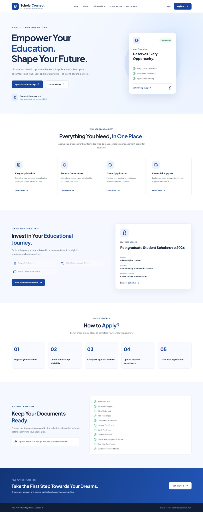

#### 2. Login Page

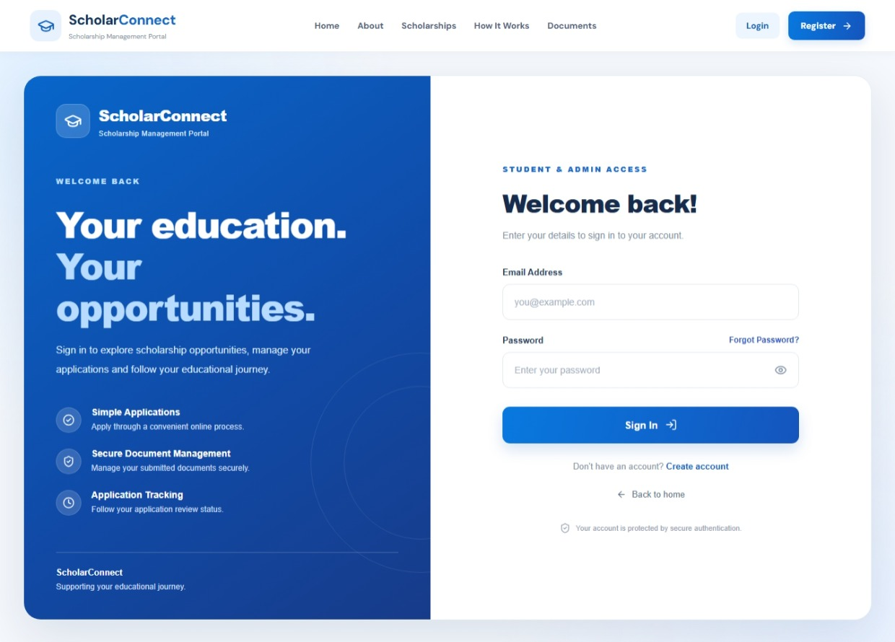

#### 3. Registration Page

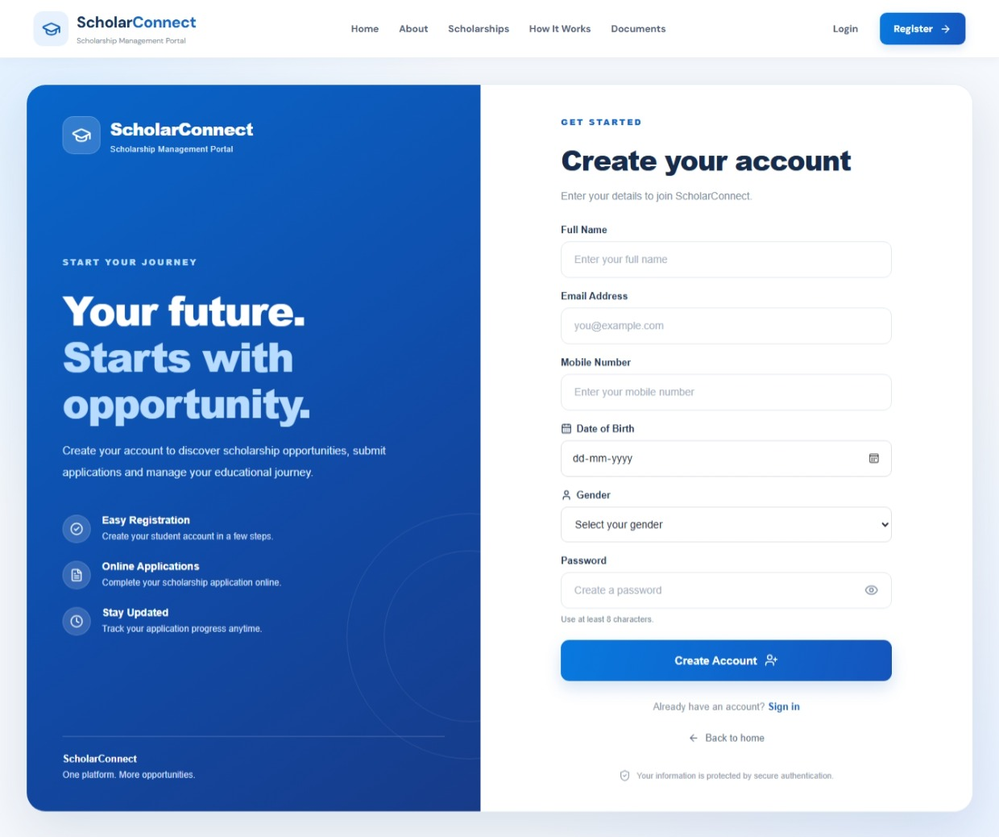

---

### 👨‍💼 Admin Screens

#### 4. Admin Dashboard

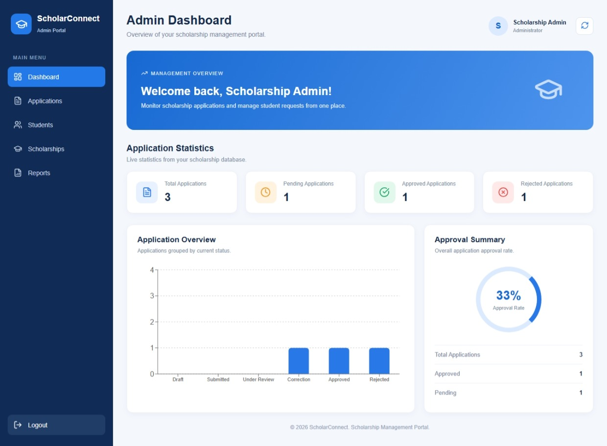

#### 5. Admin Applications

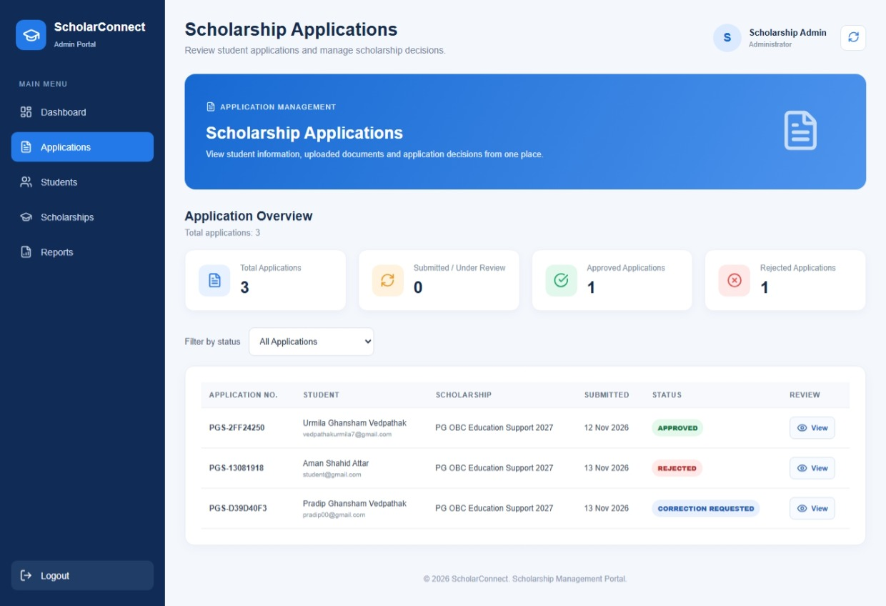

#### 6. Admin Students

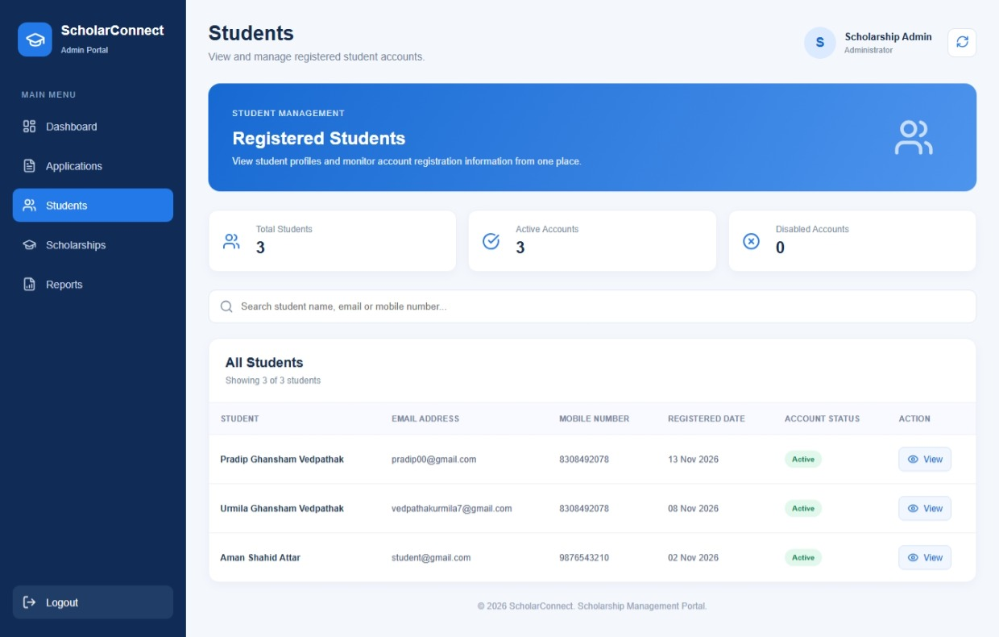

#### 7. Admin Scholarships

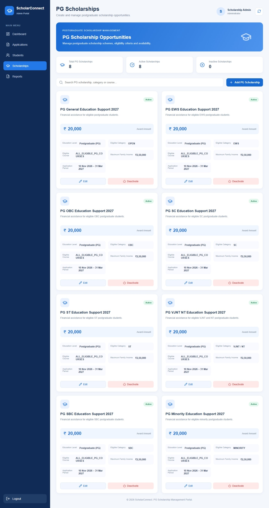

#### 8. Admin Reports

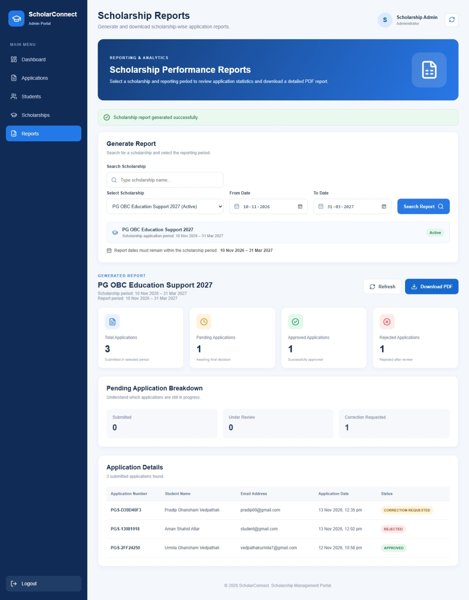

---

### 👨‍🎓 Student Screens

#### 9. Student Dashboard

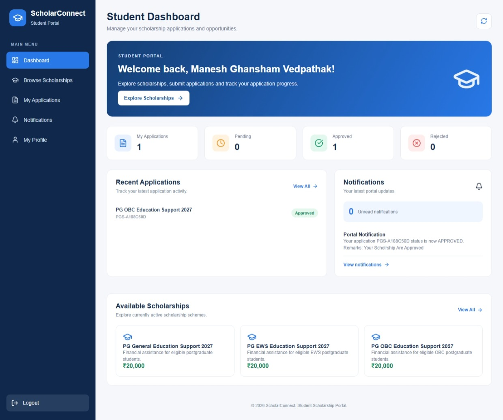

#### 10. Student Scholarships

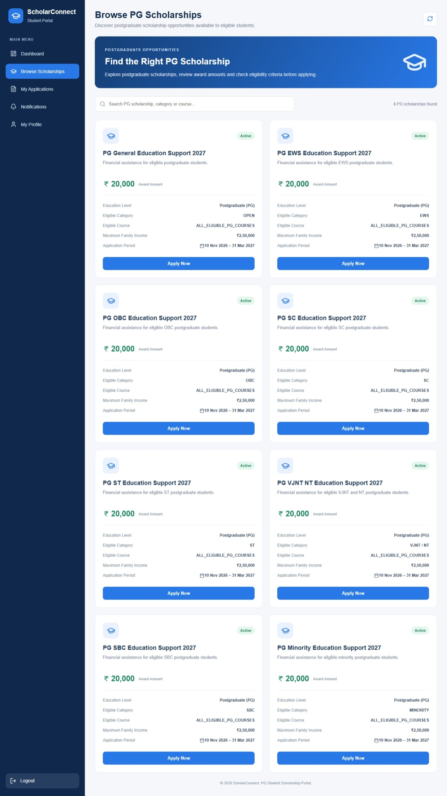

#### 11. Apply Scholarship

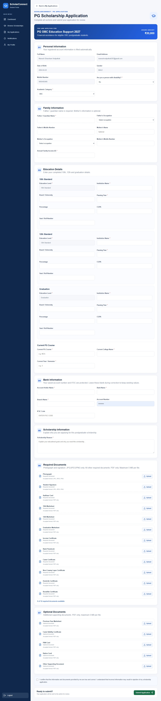

#### 12. Student Application

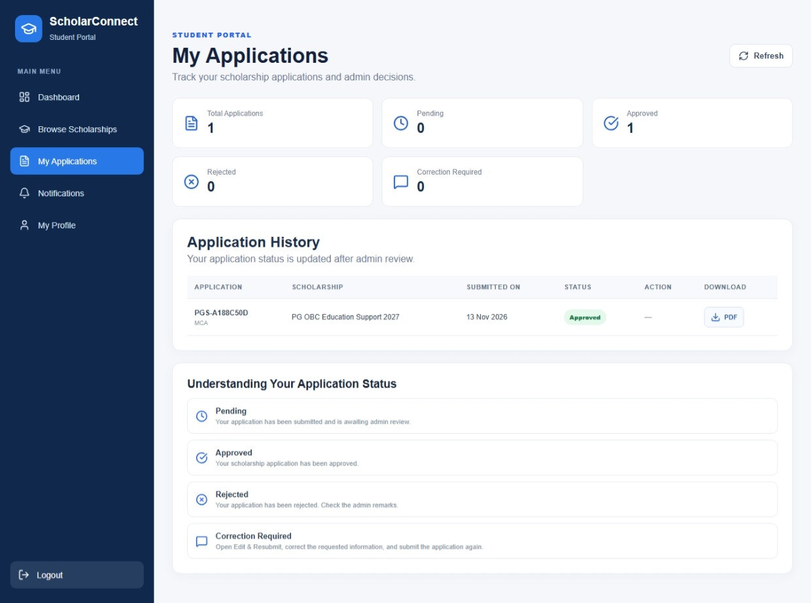

#### 13. Application PDF

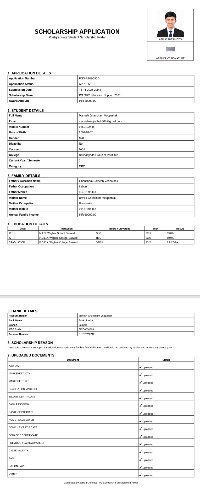

#### 14. Student Notifications

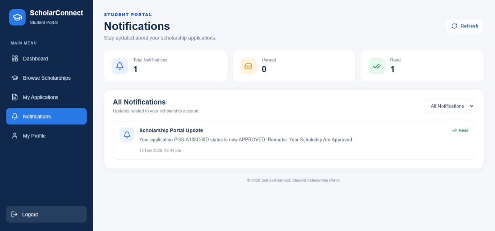

#### 15. Student Profile

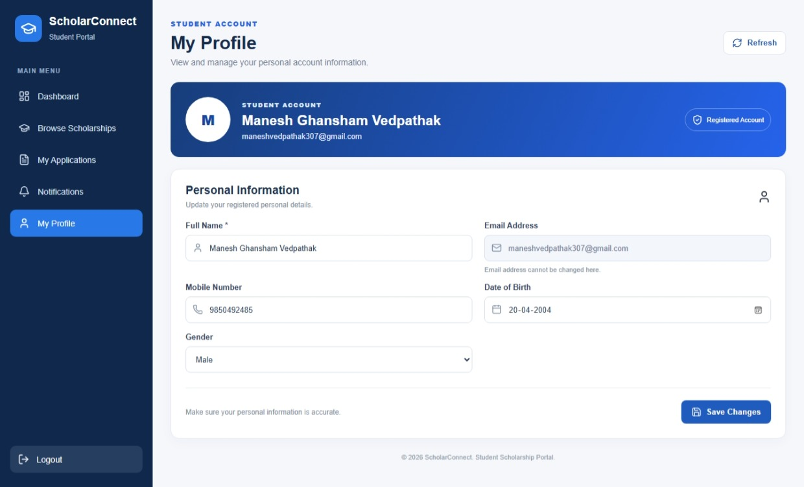

---

## 🔒 Security

The application uses:

- Spring Security
- JWT-Based Authentication
- Role-Based Authorization
- Password Hashing
- Protected REST APIs
- File Upload Validation
- Document Access Control

For production deployment, configure HTTPS, secure secrets, database backups, and appropriate access controls for uploaded documents.

---

## 🎯 Future Enhancements

- Email and SMS Notifications
- Online Scholarship Disbursement Tracking
- Advanced Scholarship Analytics
- More Scholarship Categories
- Scholarship Eligibility Automation
- Application Verification Improvements
- Advanced Admin Dashboard
- Student Application History
- Cloud Deployment
- Docker Support
- Automated Testing
- Production Database Configuration
- Mobile Application

---

## 👨‍💻 Author

**Manesh Vedpathak**

Java Full Stack Developer

React.js + Spring Boot + MySQL

---

## ⭐ Project

If you find this project useful, consider giving it a star on GitHub.

